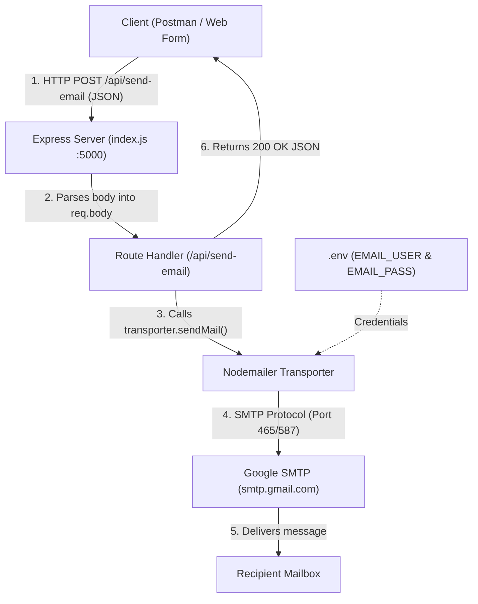

# 📧 Email Service API — Version 1.0 (V1)

A clean, beginner-friendly REST API built with **Node.js**, **Express**, and **Nodemailer** to send real emails to any address using Google's SMTP service.

---

## 🎯 1. Project Overview

The goal of **Version 1 (V1)** is simplicity and clarity:
* Everything is consolidated into a single, well-commented entry point (`index.js`).
* Eliminates boilerplate and complex abstractions so the core workflow is immediately understandable.
* Provides a functional HTTP API ready to be consumed by **Postman**, frontend web apps, or mobile clients.

---

## 🏛️ 2. V1 Architecture & Data Flow



### The 3 Core Pillars:
1. **Express Server**: Listens on port `5000` and receives incoming HTTP requests.
2. **`express.json()` Middleware**: Translates raw incoming JSON into an easy-to-use JavaScript object (`req.body`).
3. **Nodemailer Transporter**: Securely authenticates with Gmail and delivers the message to the destination email address.

---

## 📂 3. Project Structure

```text
Email-Service_test/
├── .env          # Private credentials (ignored by git)
├── .gitignore    # Prevents sensitive files from being pushed to version control
├── index.js      # Complete V1 application (~60 lines)
├── package.json  # Dependencies (express, nodemailer, dotenv)
└── README.md     # Official V1 Documentation
```

---

## 📝 4. Code Walkthrough (`index.js`)

The V1 codebase consists of 6 logical steps in a single file:

| Step | Code Section | Purpose |
| :---: | :--- | :--- |
| **1** | `require('dotenv').config()` | Loads `EMAIL_USER` and `EMAIL_PASS` securely from `.env`. |
| **2** | `const express = ...` | Imports Express and Nodemailer dependencies. |
| **3** | `app.use(express.json())` | Allows Express to read `{ "to": "...", "subject": "..." }` from requests. |
| **4** | `nodemailer.createTransport(...)` | Authenticates your sender Gmail account with Google's SMTP server. |
| **5** | `app.post('/api/send-email', ...)` | Receives `req.body`, calls `transporter.sendMail()`, and returns JSON. |
| **6** | `app.listen(PORT, ...)` | Starts the server on port `5000`. |

---

## 🔐 5. Setup & Configuration

### 5.1 Environment Variables (`.env`)
Create a `.env` file in the root folder:

```env
PORT=5000
EMAIL_USER=your-actual-email@gmail.com
EMAIL_PASS=your-16-char-app-password
```

> [!IMPORTANT]
> **Gmail App Password Requirement**:
> Standard Google account passwords will be rejected with error `535 BadCredentials`.
> 1. Go to your **[Google Account Security](https://myaccount.google.com/security)**.
> 2. Enable **2-Step Verification**.
> 3. Search for **App passwords**, create one named `Email Service`, and copy the **16-character code**.
> 4. Paste that code into `EMAIL_PASS` without spaces.

---

## 📡 6. API Reference

### Send Email Endpoint

* **URL**: `http://localhost:5000/api/send-email`
* **Method**: `POST`
* **Headers**: `Content-Type: application/json`

#### Request Body
```json
{
  "to": "recipient@example.com",
  "subject": "Exam Results Published",
  "text": "Your results are now available."
}
```

#### Fields Description
| Field | Type | Required | Description |
| :--- | :--- | :---: | :--- |
| `to` | `string` | **Yes** | Destination email address. |
| `subject` | `string` | **Yes** | Subject line of the email. |
| `text` | `string` | **Yes** | Plain text email content (also auto-wrapped in HTML). |

#### Responses

**Success (`200 OK`):**
```json
{
  "success": true,
  "message": "Email sent successfully!",
  "messageId": "<b47b69de-b754-6670-fabb-77f69aa3c1d1@gmail.com>"
}
```

**Failure (`500 Internal Server Error`):**
```json
{
  "success": false,
  "error": "Invalid login: 535-5.7.8 Username and Password not accepted."
}
```

---

## 🧪 7. Testing Guide

### Option 1: Testing with Postman
1. Start the server:
   ```bash
   node index.js
   ```
2. In Postman:
   * Set Method dropdown to: **`POST`**
   * URL: **`http://localhost:5000/api/send-email`** *(Do not type "POST" in the URL bar)*
   * Select **Body** $\to$ **raw** $\to$ choose **JSON**
   * Paste:
     ```json
     {
       "to": "buddhidassanayke@gmail.com",
       "subject": "Exam Results Published",
       "text": "Your results are now available."
     }
     ```
3. Click **Send**.

---

### Option 2: Testing with PowerShell (Terminal)
```powershell
Invoke-RestMethod -Uri "http://localhost:5000/api/send-email" `
  -Method Post `
  -ContentType "application/json" `
  -Body '{"to":"buddhidassanayke@gmail.com","subject":"Terminal Test","text":"Testing V1 API!"}'
```

---

## 💡 8. Common Pitfalls & Solutions

| Issue | Reason | Solution |
| :--- | :--- | :--- |
| **`401 Unauthorized` (Grafana)** | Port 3000 is occupied by another service (Grafana). | We use **Port 5000** in V1 to avoid collisions. |
| **`Error: Invalid protocol: post http`** | Typed `POST` inside the Postman URL input. | Keep only `http://localhost:5000/api/send-email` in the URL bar. |
| **`535 Bad Credentials`** | Used regular Gmail password instead of App Password. | Generate a 16-character Google App Password with 2FA enabled. |

---

## 🔮 9. V2 Roadmap (Future Enhancements)

When you are ready to expand the project in **Version 2 (V2)**:
* [ ] Separate into layers (`routes.js`, `emailService.js`, `controllers/`).
* [ ] Support file attachments (PDFs, images).
* [ ] Add dynamic HTML email templates (Handlebars or EJS).
* [ ] Add input validation (Joi or express-validator) and rate limiting.
